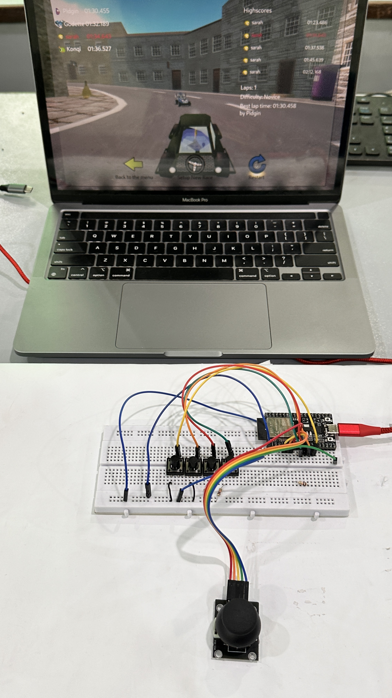

# ESP32 Bluetooth Gamepad

A DIY Bluetooth Low Energy (BLE) gamepad built with an ESP32 development board, one analog joystick, and four push buttons. The ESP32 advertises as **ESP32 Custom Pad** and sends standard gamepad axes and button inputs to a paired device.

## Features

- Left joystick reports horizontal and vertical axes.
- Four external buttons report gamepad buttons 1–4.
- The joystick push switch reports gamepad button 5.
- Joystick center is sampled at startup; keep the stick untouched and centered while the board boots.
- A small dead zone filters minor analog noise near the center.

## Hardware and wiring

| Part / signal | ESP32 GPIO |
| --- | ---: |
| Joystick VRX (horizontal) | 34 |
| Joystick VRY (vertical) | 35 |
| Joystick push switch (SW) | 32 |
| External button 1 | 12 |
| External button 2 | 14 |
| External button 3 | 27 |
| External button 4 | 26 |

Connect the joystick's **VCC** to **3.3 V** and **GND** to **GND**. Connect each button between its listed GPIO and **GND**. The sketch uses `INPUT_PULLUP`, so a pressed button reads LOW. Do not connect an ESP32 GPIO to 5 V.

The button pin numbers in the table must match the actual breadboard wiring. If the hardware is rewired, update `BUTTON_PINS` in the sketch to match.

## Software requirements

- Arduino IDE 2.x
- Espressif's `esp32` board package
- `ESP32-BLE-Gamepad` by lemmingDev
- `NimBLE-Arduino` by h2zero

The gamepad library currently used by this project is version 0.8.0, with NimBLE-Arduino 2.5.2. Install both through Arduino IDE Library Manager. Select **ESP32 Dev Module** for a generic ESP32 DevKit board.

## Build and upload

1. Open `ESP32_Gamepad.ino` in Arduino IDE.
2. Connect the ESP32 to the computer with a USB data cable.
3. Select **Tools → Board → esp32 → ESP32 Dev Module** (or the exact board model if known).
4. Select the ESP32's serial port under **Tools → Port**.
5. Leave the joystick centered, click **Verify**, then click **Upload**.
6. After upload, the controller starts advertising over BLE while the ESP32 is powered.
7. Pair **ESP32 Custom Pad** from the host device's Bluetooth settings.

The sketch remains stored in the ESP32 after USB is unplugged. The board still needs power to run; use USB power or a suitable battery/power supply. The value `100` in the gamepad constructor is a reported battery percentage, not a measurement of a real battery.

## Game controls

The sketch sends the joystick as the left stick, four buttons as gamepad buttons 1–4, and the joystick click as button 5. Game actions are assigned by each game's control settings.

For SuperTuxKart, open **Options → Controls**, select **ESP32 Custom Pad**, then bind left/right steering to the horizontal axis and acceleration/reverse to the vertical axis. Bind the game's other actions to buttons 1–5 as desired. Axis direction labels vary by host and game; if pushing the stick forward activates reverse, swap the accelerate and brake/reverse bindings in the game.

## Troubleshooting

- **Controller is not listed in Bluetooth:** Confirm the ESP32 is powered, upload completed successfully, and the sketch is running. Disconnecting USB from the computer powers the board off unless another power source is connected.
- **No serial port in Arduino IDE:** Try a USB data cable and another port. Some ESP32 boards need a USB-to-serial driver matching the board's USB chip (commonly CP210x or CH340).
- **Joystick moves the kart while centered:** Restart the board with the joystick centered so startup calibration can sample its resting position. Increase `DEADZONE` slightly if the axis still jitters.
- **A button does not register:** Confirm the sketch's `BUTTON_PINS` matches the wiring and that pressing the button connects its GPIO to GND. In game settings, verify the action is assigned to the corresponding gamepad button.
- **Nitro, skidding, or rescue appears to do nothing:** These are game-specific actions and may require available boost, steering while skidding, or a stuck kart.

## Repository contents

- `ESP32_Gamepad.ino` — Arduino sketch
- `README.md` — project overview, wiring, setup, controls, and troubleshooting
- `.gitignore` — excludes common local build and operating-system files

